<!-- The graphics are generated by tools/build.py from novista.io's own copy. Edit the copy there and rerun it. -->

<a href="https://novista.io"></a>

  &nbsp;
  &nbsp;
  

 

<picture>
  <source media="(prefers-color-scheme: dark)" srcset="assets/h-services-dark.svg">
  
</picture>

  <a href="https://novista.io/services/web-development"></a>
  <a href="https://novista.io/services/mobile-development"></a>
  <a href="https://novista.io/services/ai-solutions"></a>
  <a href="https://novista.io/services/digital-transformation"></a>

 

<picture>
  <source media="(prefers-color-scheme: dark)" srcset="assets/h-platforms-dark.svg">
  
</picture>

<a href="https://novista.io/products"></a>

  

<picture>
  <source media="(prefers-color-scheme: dark)" srcset="assets/h-process-dark.svg">
  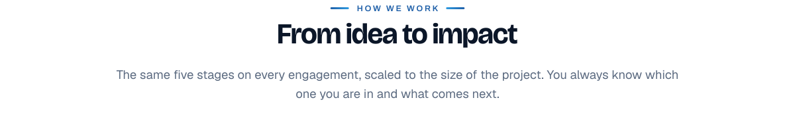
</picture>

<a href="https://novista.io/about#process"></a>

  

<picture>
  <source media="(prefers-color-scheme: dark)" srcset="assets/h-stack-dark.svg">
  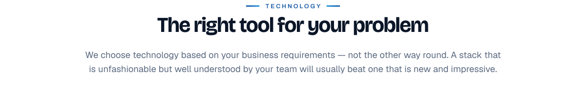
</picture>


  

<picture>
  <source media="(prefers-color-scheme: dark)" srcset="assets/h-team-dark.svg">
  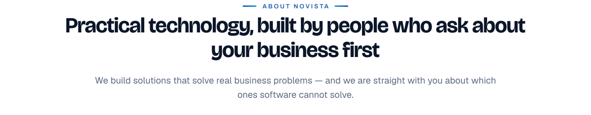
</picture>

  <a href="https://novista.io/about"></a>
  <a href="https://novista.io/about"></a>

 

<a href="https://novista.io/contact"></a>

  &nbsp;
  &nbsp;
  

Novista Solutions · Custom software, AI automation and digital platforms · <a href="https://novista.io">novista.io</a>

